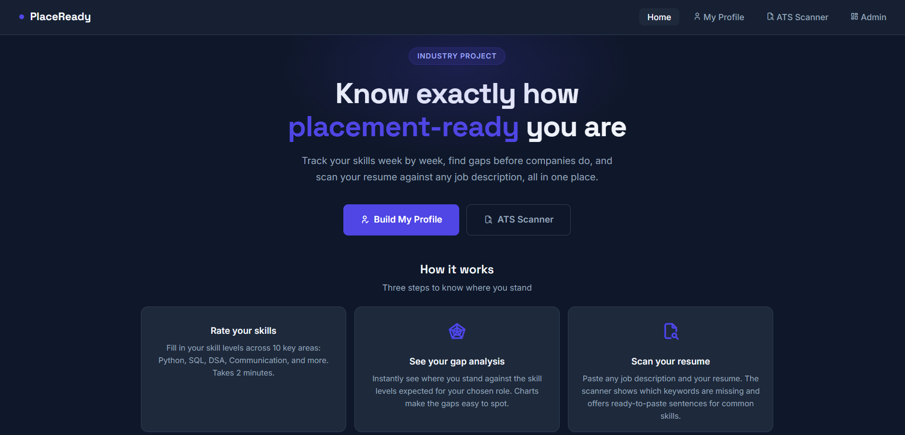
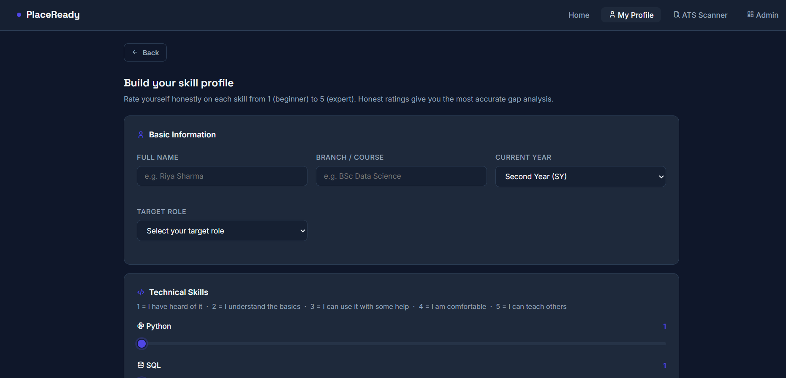

# PlaceReady: Placement Readiness Tracker

A web app that helps students see how ready they are for campus placements, which skills to work on first, and which keywords their resume is missing for a given job description. It also gives the placement cell a ranked view of the whole batch.

Built as a Semester 3 industry project (BSc Data Science and Business Analytics).

## Live demo
[](https://placeready-tracker.onrender.com)

*Free-tier hosting: the first visit after a quiet period can take about a minute to wake up. Demo data may be reset, so please use fake names only. There is no login.*






## Features

* **Readiness score (0-100):** 60 points from ten self-rated skills plus 40 points from weekly activity.
* **Skill-gap analysis:** compares each skill with the level expected for the chosen role (Data Analyst, Data Scientist, Business Analyst, Data Engineer, Software Developer, ML Engineer).
* **Charts (Chart.js):** a radar chart of skills vs. the role benchmark, and a line chart of the score over time.
* **Priority actions:** the five biggest gaps, each with a practice tip.
* **ATS scanner:** paste a resume and a job description; see matched, missing and unused keywords and a match percentage. 22 common skills come with ready-to-paste resume sentences. It runs entirely in the browser, so nothing is uploaded.
* **Admin dashboard:** every student ranked by score with Ready / Warning / Critical badges. Skill colours are judged against each student's own target role.
* **JSON API and docs:** `/api/student/{id}`, `/api/benchmark/{role}`, and FastAPI's interactive docs at `/docs`.

## Tech stack

Python, FastAPI, Uvicorn, SQLite, Jinja2, JavaScript, Chart.js, HTML/CSS.
Exact Python package versions are pinned in `requirements.txt`.

## Run it

```bash
python -m venv venv
venv\\Scripts\\activate          # Windows   (macOS/Linux: source venv/bin/activate)
pip install -r requirements.txt
python main.py / uvicorn main:app --reload
```

Open http://127.0.0.1:8000. The database file `placement.db` is created automatically on first run.
Charts and icons load from a CDN, so the first page load needs an internet connection.

## How it works

|File|Job|
|-|-|
|`main.py`|Routes: which URL shows which page, and what happens when the profile form is submitted|
|`database.py`|All SQLite reads/writes, and the role benchmarks (`BENCHMARKS`)|
|`analytics.py`|Score formula, risk label, skill gaps, priority actions|
|`templates/`|Jinja2 pages (`base.html` holds the shared navbar)|
|`static/css/style.css`|All styling|

**Submitting a profile:** form -> `main.py` validates it -> `analytics.py` computes the score -> `database.py` saves it -> redirect to the dashboard.
Submitting again with the same name (any capitalisation) **updates** that student and adds a new point to the progress chart; it does not create a duplicate.

### Score formula

```
skill score    = ((sum of 10 skill ratings - 10) / 40) \* 60
activity score = min(problems,10)/10\*15 + min(mocks,3)/3\*15 + min(projects,1)\*5 + min(courses,1)\*5
readiness      = skill score + activity score          (maximum 100)
```

Zones: below 40 Critical, 40 to under 70 Warning, 70 and above Ready.

### Add a target role

Add one line to `BENCHMARKS` in `database.py` and restart. The profile dropdown and gap analysis pick it up automatically.
The ten numbers are the level (1-5) the role expects for: Python, SQL, DSA, Excel, Power BI, ML, Communication, Aptitude, Statistics, Domain.

## Known limitations

* **No login.** A student is identified by name only. Two different people with the same name would share one record, and `/admin` is open to anyone who can reach the server.
* **Benchmarks are illustrative.** The role requirements are values chosen by the author, not the result of a statistical study.
* **No machine-learning model.** The score is a transparent formula. A prediction model needs real historical placement data, which this project does not have.
* **ATS scan history is not saved.** The `ats\_scans` table exists for future use, but the browser-based scanner does not write to it yet.
* **ATS matching is simple keyword overlap** with an English stopword list. It is a teaching model of how keyword filters work, not a copy of any real ATS product. Multi-word skills (for example "power bi") are counted both as a phrase and as separate words.
- **Free-tier demo hosting.** The live demo runs on a free tier with a SQLite file, so it can sleep and its data can be reset. It is not set up for production use.
## Roadmap

User accounts and login, saving ATS scans, PDF resume upload, and a prediction model trained on real placement data.

